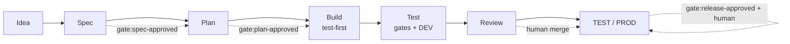

# Power BI Superpower

**A local-first delivery kit for Power BI semantic models and reports.** Use GitHub Copilot in VS Code or Copilot CLI to take an idea through specification, planning, test-first development, review and deployment. The kit combines [Superpowers](https://github.com/obra/superpowers), Microsoft's Power BI authoring tools, and PowerShell automation. **No GitHub Actions. Humans own approvals, merges and every PROD change.**

> **Readiness, 30 October 2026:** this is an imported working-tree baseline, not a proven factory release. The assessment found 160/180 Pester tests passing, failing commit/PR gates, missing authoring tools and an EULA-blocked Modeling MCP. See the [verified readiness intake](docs/analysis/development-readiness.md) and [issue #1](https://github.com/urruegg/power-bi-superpower/issues/1). Do not start a real report until the readiness blockers and human gates are resolved.



## What you can build

| Artifact | Repository support |
|---|---|
| **Semantic models** | TMDL tables, relationships, Power Query parameters, explicit DAX measures and role definitions; independent DAX tests |
| **Interactive reports** | PBIR pages, visuals, filters, themes and accessibility; scaffolded from a report blueprint, then validated and visually reviewed |
| **Executive overview pages** | Dashboard-style report pages using the same PBIR workflow |
| **Power BI service dashboards** | A different artifact: tiles pinned from published reports in the service, not a Desktop/PBIR file. Dashboard creation and tile deployment are **not implemented** by this kit; arrange an explicit human-owned service step if required |
| **DEV/TEST/PROD releases** | Scripts for workspace infrastructure, model/report definitions, environment parameters, report rebinding, refresh and post-deployment tests; PROD is human-only |

This is not a data-ingestion platform or an unattended production publisher. You supply the business decision, KPI definitions and trusted expected values, data access, security requirements and human approvers. Credentials, gateways, RLS membership, sensitivity labels and app audiences remain service-side human work.

## What is included

| Layer | Contents |
|---|---|
| **Custom agents** (`.github/agents`) | `pbi-sprint-lead`, `pbi-spec-architect`, `pbi-planner`, `pbi-model-engineer`, `pbi-report-engineer`, `pbi-quality-engineer`, `pbi-reviewer` (read-only), `pbi-release-manager` |
| **Skills** (`.github/skills`) | `pbi-sprint-flow` (router), `pbi-sprint-start`, `pbi-idea-intake`, `pbi-spec`, `pbi-plan`, `pbi-semantic-model`, `pbi-dax-tdd`, `pbi-report-pbir`, `pbi-rls-security`, `pbi-quality-gates`, `pbi-deploy`, `pbi-sprint-review` — on top of Superpowers and Microsoft's `powerbi-authoring` plugin |
| **Guardrails** (`.github/hooks`, `AGENTS.md`) | Session context; blocks PROD deployments, merges, pushes to `main`, force-push, destructive calls, `gate:*` labels, secret files and unrestricted sessions |
| **MCP** (`.vscode/mcp.json`, `.github/mcp.json`) | Power BI Modeling MCP, Fabric MCP, Microsoft Learn, GitHub, Playwright |
| **PowerShell IaC** (`scripts/`) | Bootstrap, report scaffolding, quality gates (structure, BPA, report conventions, DAX tests, screenshots), workspace provisioning, PBIP deployment with parameters and report rebinding, refresh, post-deployment tests, sprint management |
| **Work management** (`config/github`, `.github/ISSUE_TEMPLATE`) | Issue forms, labels (phases, human gates), ruleset, project, PR template with evidence |
| **Starter project** ([SalesStarter](src/SalesStarter/README.md)) | Synthetic TMDL model, 7 measures, DAX tests and report blueprint; the report and PBIP entry file still need scaffolding |
| **Docs** (`docs/`) | Capability analysis, operating model, ADRs, setup, first sprints, runbooks, evidence register |

## Start here (Windows)

Use the [setup guide](docs/getting-started/setup.md) for a new workstation. From an **existing checkout**, start with read-only checks, not repository creation:

```powershell
pwsh -NoProfile -File .\scripts\sprint\Get-PbiSprintStatus.ps1
pwsh -NoProfile -File .\scripts\bootstrap\Test-Prerequisites.ps1
pwsh -NoProfile -Command "Invoke-Pester -Path .\tests\powershell -Output Detailed"
pwsh -NoProfile -File .\scripts\quality\Invoke-PbiQualityGate.ps1 -Profile commit
```

No current sprint means the status command exits **2**; it does not mean there are no readiness blockers. If downloaded scripts are blocked, follow the [trusted-download instructions](docs/getting-started/setup.md#downloaded-scripts-and-execution-policy), not an execution-policy bypass.

Review the tool installation plan before changing your workstation:

```powershell
pwsh -NoProfile -File .\scripts\bootstrap\Install-PbiTooling.ps1 -WhatIf
copilot plugin list
code .
```

In Chat, select `pbi-sprint-lead` and use:

> Use using-superpowers, pbi-sprint-flow and brainstorming. Read issue #1 and the readiness intake. Propose the readiness sprint goal, scope and capacity for human agreement. Do not apply gate labels or start implementation.

The [first-sprint guide](docs/getting-started/first-sprint.md) explains the walking skeleton and the current Sprint 0 numbering mismatch. Installing plugins, passing a static check or seeing MCP tools in the picker does **not** prove that Desktop authoring or deployment works.

## Build your first real artifact

1. **Describe the decision.** Use the [idea form](.github/ISSUE_TEMPLATE/01-idea.yml), or ask `pbi-sprint-lead` to run intake. Include audience, usage frequency, KPIs with independently sourced example values, data ownership/refresh, RLS and deadline.
2. **Agree the spec.** After the product owner accepts the intake into `phase:spec`, `pbi-spec-architect` produces the spec and report blueprint. A human applies `gate:spec-approved`.
3. **Approve the plan.** `pbi-planner` breaks the spec into test-first tasks. A human applies `gate:plan-approved` before project scaffolding, model changes or report construction.
4. **Build and verify.** Engineer agents create DAX tests before measures, scaffold PBIR with the official CLI, validate after each batch, and collect Desktop test/render evidence. Never edit the same model through live MCP and files concurrently.
5. **Review and promote.** Paste quality-gate and DEV evidence in the PR. A human merges; the release manager promotes the same reviewed source to TEST. PROD requires release approval and execution by a human.

See the [artifact walkthrough](docs/getting-started/first-sprint.md#sprint-1--first-real-report-two-weeks) for commands, prompts and expected outputs.

## How a sprint runs

| Phase | Agent | Key skills | Output | Human gate |
|---|---|---|---|---|
| Intake | `pbi-sprint-lead` | `pbi-idea-intake` | Scored idea | accept → `phase:spec` |
| Spec | `pbi-spec-architect` | Superpowers `brainstorming` + `pbi-spec` | Spec, blueprint, draft PR | `gate:spec-approved` |
| Plan | `pbi-planner` | Superpowers `writing-plans` + `pbi-plan` | Plan, sub-issues | `gate:plan-approved` |
| Build | `pbi-model-engineer`, `pbi-report-engineer` | `subagent-driven-development`, `test-driven-development`, `pbi-dax-tdd`, `pbi-semantic-model`, `pbi-report-pbir` | Commits, tests first | task review |
| Test | `pbi-quality-engineer` | `verification-before-completion`, `pbi-quality-gates` | Evidence, DEV deployment | all checks pass |
| Review | `pbi-reviewer` | `requesting-code-review` | PR review | **human merge** |
| Deploy | `pbi-release-manager` | `finishing-a-development-branch`, `pbi-deploy` | TEST deployment, release issue | `gate:release-approved`, **human runs PROD** |
| Sprint review | `pbi-sprint-lead` | `pbi-sprint-review`, `writing-skills` | Release notes, retro, better skills | sprint accepted |

## Repository layout

```
AGENTS.md                      rules for agents (start here)
.github/                       agents, skills, instructions, hooks, issue forms, PR template, MCP (CLI), plugin defaults
.vscode/                       MCP (VS Code), tasks, settings
config/environments/           DEV / TEST / PROD (no IDs; ${env:…} placeholders)
config/quality/                gate profiles, thresholds, BPA rules
config/github/                 labels, ruleset, project
scripts/                       PowerShell: bootstrap, build, quality, infra, deploy, sprint, hooks, module
src/<Project>/                 PBIP: <Project>.SemanticModel (TMDL + DAXQueries tests), <Project>.Report (PBIR), report-blueprint.json
templates/                     new-project template
tests/powershell/              Pester tests for the scripts
tools/versions.json            pinned tools and plugins
docs/                          analysis, operating model, ADRs, guides, runbooks, sprints, specs, plans
```

## Evidence and limits

- [Readiness intake](docs/analysis/development-readiness.md): measured baseline, MCP/tool/skill inventory, proposed remediation and development-entry criteria.
- [Evidence register](docs/evidence-register.md): official capability sources and unresolved verification spikes. A dated analysis is not installation evidence.
- [Setup](docs/getting-started/setup.md), [troubleshooting](docs/runbooks/troubleshooting.md), [contributing](CONTRIBUTING.md) and [deployment runbook](docs/runbooks/deploy.md).
- Local Power BI authoring needs Windows and Desktop. The hosted Modeling MCP is preview and cannot reach local Desktop/PBIP files. Choose one authoring-server registration to avoid ambiguous routing.
- Tool versions include floating `latest` references and minimum versions, not universal exact pins. Reconcile and record actual versions before trusting a build.
- Required skipped checks block the gate. Screenshots require an attended human review. `.evidence/` contains local evidence; paste only masked summaries into PRs.
