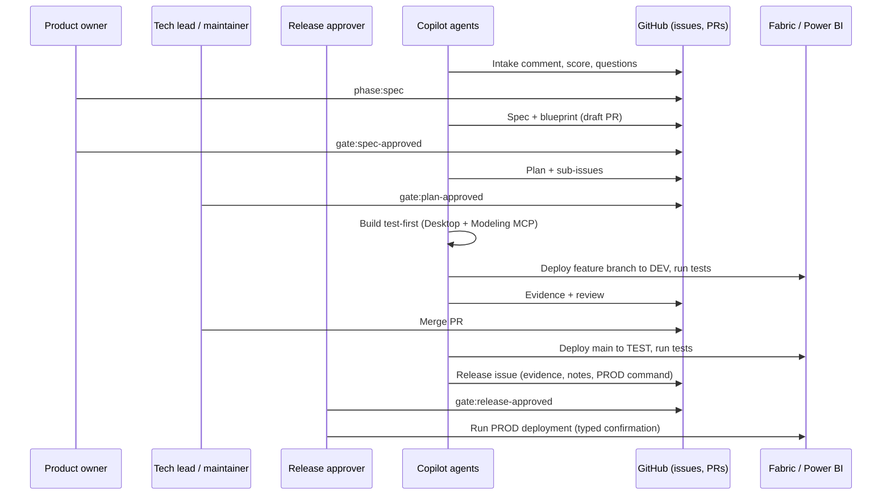

# Operating model — agent-driven Power BI sprints

How ideas become deployed Power BI content in this repository: who does what, which agent and skill runs each step, where artefacts live, and which human decision opens each gate. The capability research behind it is in `docs/analysis/capability-analysis.md`.

## 1. Principles

| # | Principle | In practice |
|---|---|---|
| P1 | Specify before you build | No build without an approved spec (`gate:spec-approved`) and plan (`gate:plan-approved`). |
| P2 | Everything as code | Models (TMDL), reports (PBIR), tests (DAX), environments (JSON), infrastructure (PowerShell), agents and skills live in Git. Nothing is edited in the service. |
| P3 | Tests first | Every measure starts with a failing DAX test whose expected value comes from an independent source. |
| P4 | Humans own the gates | Agents propose; people approve specs, plans, merges and releases. Hooks enforce it. |
| P5 | One deployment path | Only `scripts/deploy/*.ps1` and `scripts/infra/*.ps1` change workspaces. No Desktop publishing, no MCP deploys. |
| P6 | Evidence over claims | Every gate writes evidence; PRs and release issues carry the masked summary. Skipped is never passed. |
| P7 | No identifiers or personal data in Git | Placeholders and `.env.local`; synthetic sample data; hygiene gate. |
| P8 | Verify on Microsoft Learn | Capabilities are checked with the Learn MCP server and recorded in `docs/evidence-register.md`. |
| P9 | Pinned supply chain | Tools, plugins and Superpowers are pinned in `tools/versions.json` and upgraded through PRs. |

## 2. Flow

```mermaid
flowchart LR
    A[Idea issue<br/>phase:intake] -->|PO accepts| B[Spec<br/>brainstorming + pbi-spec]
    B -->|gate:spec-approved| C[Plan<br/>writing-plans + pbi-plan]
    C -->|gate:plan-approved| D[Build<br/>TDD per task]
    D --> E[Test<br/>quality gates + DEV deploy]
    E --> F[Review<br/>pbi-reviewer]
    F -->|human merges| G[TEST deploy<br/>from main]
    G -->|gate:release-approved| H[PROD deploy<br/>human runs script]
    H --> I[Sprint review<br/>release notes, retro, skills]
```

## 3. Roles

| Role | Human or agent | Responsibilities | Never |
|---|---|---|---|
| Product owner | Human | Accepts ideas, approves specs, sets priorities, accepts sprint results | — |
| Data owner | Human | Confirms data sources, KPI definitions, security rules; assigns RLS membership in the service | — |
| Tech lead / maintainer | Human | Approves plans, reviews and merges PRs, owns CODEOWNERS paths | — |
| Release approver | Human | Approves PROD releases and runs the PROD deployment | Delegates PROD to an agent |
| `pbi-sprint-lead` | Agent | Sprint start, intake, status, sprint review | Applies gates, merges |
| `pbi-spec-architect` | Agent | Spec and blueprint | Changes models |
| `pbi-planner` | Agent | Plan and sub-issues | Implements |
| `pbi-model-engineer` | Agent | Semantic model, test-first | Touches TEST/PROD |
| `pbi-report-engineer` | Agent | Report pages and visuals | Hand-writes report shells |
| `pbi-quality-engineer` | Agent | Gates, DEV deployment, evidence | Relaxes thresholds without ADR |
| `pbi-reviewer` | Agent (read-only) | PR review | Edits, approves on behalf of humans |
| `pbi-release-manager` | Agent | TEST deployment, release issue, changelog | Runs PROD, applies gates |

## 4. Artefacts and where they live

| Artefact | Location | Produced in |
|---|---|---|
| Idea, feature, task, bug, sprint, release issues | GitHub issues (forms in `.github/ISSUE_TEMPLATE/`) | All phases |
| Sprint document | `docs/sprints/sprint-NN/sprint.md`, pointer `docs/sprints/current.json` | Sprint start / review |
| Spec | `docs/superpowers/specs/YYYY-MM-DD-<issue>-<slug>-design.md` | Spec |
| Report blueprint | `src/<Project>/report-blueprint.json` | Spec |
| Plan | `docs/superpowers/plans/YYYY-MM-DD-<issue>-<slug>.md` + sub-issues | Plan |
| Model, tests, report | `src/<Project>/…` | Build |
| Evidence | `.evidence/` (local, git-ignored) → masked summaries in PRs and release issues | Test, Deploy |
| Release notes / changelog | Release issue, `CHANGELOG.md` | Deploy, Sprint review |
| Decisions | `docs/architecture/adr/` | Any phase |

## 5. Gates

| Gate | Evidence required | Who |
|---|---|---|
| Intake accepted | Intake comment with score and recommendation | Product owner (`phase:spec`) |
| `gate:spec-approved` | Spec checklist complete, acceptance tests with sources, open questions owned | Product owner (+ data owner) |
| `gate:plan-approved` | Every KPI and test mapped to a task; verification command per task | Tech lead |
| PR merge | `-Profile pr` evidence on the last commit, DEV deployment evidence, review resolved | Maintainer |
| TEST deploy | Merged to `main`, clean tree | Release manager agent (allowed) |
| `gate:release-approved` | TEST evidence for the release commit, release notes, rollback note | Release approver |
| PROD deploy | All `prod.json` guards + typed confirmation | Release approver runs it |

## 6. Branching and environments

- `main` is protected (ruleset): pull requests only, linear history, no force-push or deletion.
- One branch per feature from the Spec phase: `feat/<issue>-<slug>` (Superpowers worktree in `.worktrees/`). Draft PR from the first commit.
- DEV ← any branch (developer or agent). TEST ← `main`. PROD ← `main`, same commit as TEST, human only.

## 7. Cadence (two-week sprint)

| Day | Event | Agent support |
|---|---|---|
| 1 | Sprint start | `pbi-sprint-lead`: goal, scope, milestone |
| 1–2 | Specs for committed ideas | `pbi-spec-architect` |
| 2–3 | Plans | `pbi-planner` |
| 3–9 | Build, test, review, merge, TEST | engineers, quality, reviewer, release manager |
| 9 | Release approval and PROD | release approver (+ release manager prep) |
| 10 | Sprint review and retro | `pbi-sprint-lead` |

## 8. Guardrails (defence in depth)

1. `AGENTS.md` and skills state the rules.
2. Copilot `preToolUse` hook (`scripts/hooks/GuardrailRules.ps1`) blocks: PROD deployments, merges, pushes to `main`, force-pushes, destructive calls, `gate:*` labels, secret files, unrestricted Copilot sessions.
3. Script guards in `config/environments/*.json` (branch, clean tree, merged, TEST evidence, approval label, human-only with typed confirmation).
4. Repository ruleset and CODEOWNERS.
5. Hygiene gate (IDs, secrets, personal data) on every commit (`.githooks/pre-push`).
